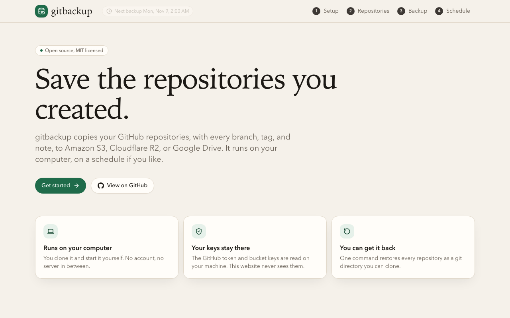
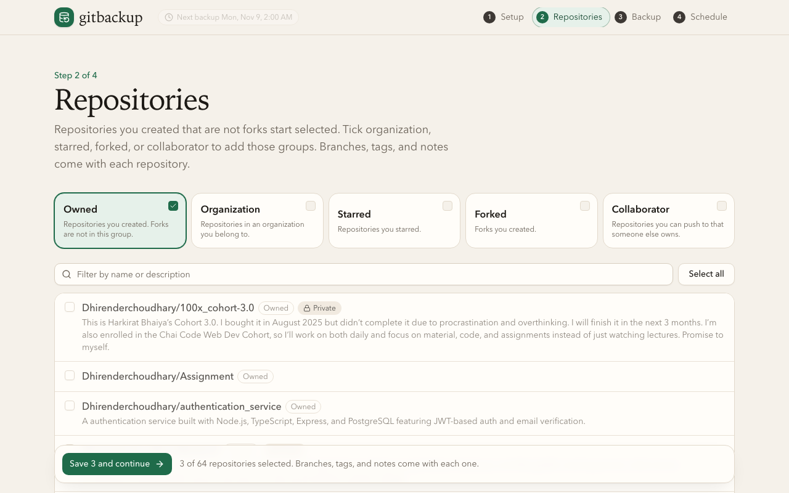
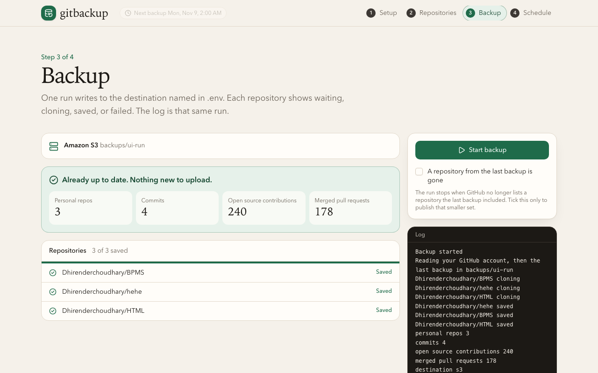

# gitbackup

Back up the GitHub repositories you created, with every branch, tag, and note, to Amazon S3, Cloudflare R2, or Google Drive. It runs on your own computer, from a small local app or the terminal, and restores to plain git repositories you can clone.

[](https://github.com/Dhirenderchoudhary/gitbackup/actions/workflows/ci.yml)
[](LICENSE)




## Why

GitHub is where your code lives, not a backup of it. An account lockout, a deleted repository, or a mistaken force-push can take history with it. gitbackup keeps a second copy in storage you own, and checks that what it uploaded matches what it built before it calls a run done.

- **Your keys stay on your machine.** The token and bucket keys never leave the computer that runs the backup.
- **Full history.** Each repository is mirrored with all branches, tags, and notes. Git LFS objects come along when `git lfs` is installed.
- **Safe by default.** A run refuses to publish a smaller backup when a repository disappears from GitHub, unless you say so.
- **Incremental.** Run it again with no new commits and nothing is uploaded. The run reports `unchanged`.
- **Restorable.** One command brings every repository back as a bare git directory.

## Quick start

You need git and Node.js 22.18 or newer.

```sh
git clone https://github.com/Dhirenderchoudhary/gitbackup.git
cd gitbackup
cp .env.example .env
npm install
npm run dev
```

Before `npm run dev`, open `.env`, set `GITBACKUP_TO` to `s3`, `r2`, or `drive`, and fill in that destination's block ([Destinations](#destinations)). Then open http://127.0.0.1:3000 and follow the four screens.

1. **Setup.** Paste a GitHub token, or leave it empty to use `GITHUB_TOKEN` from `.env`.
2. **Repositories.** Repositories you created start selected. Tick organization, starred, forked, or collaborator to add more. Search to narrow a long list.
3. **Backup.** The page shows which destination `.env` names. Press Start and watch each repository go from waiting to saved.
4. **Schedule.** Run it daily, weekly, or monthly while the app stays open. On a Mac, a menu-bar icon shows the next run.





The app listens on 127.0.0.1 only. Other machines on your network cannot reach it, and other websites cannot change its settings.

## GitHub token

A classic token with the `repo` scope is enough. Add `read:org` to include organization repositories. [This link](https://github.com/settings/tokens/new?scopes=repo,read:org&description=gitbackup) opens the form with both ticked. A fine-grained token needs read access to contents and metadata.

A token typed on the Setup screen is stored in `~/.config/gitbackup/settings.json` with permissions `600`, and it is used before `GITHUB_TOKEN` in `.env`.

## Destinations

One run writes to one destination. From the gitbackup folder, check what the next run will use without backing anything up:

```sh
npx gitbackup check
```

**Amazon S3.** Set `GITBACKUP_TO=s3`, `S3_BUCKET`, `AWS_ACCESS_KEY_ID`, and `AWS_SECRET_ACCESS_KEY`. `AWS_REGION` defaults to `us-east-1`. Set `S3_ENDPOINT` for any other service that speaks the S3 API, such as MinIO.

**Cloudflare R2.** Set `GITBACKUP_TO=r2`, `R2_BUCKET`, `R2_ACCOUNT_ID`, `R2_ACCESS_KEY_ID`, and `R2_SECRET_ACCESS_KEY`.

**Google Drive.** Set `GITBACKUP_TO=drive`, `GOOGLE_CLIENT_ID`, and `GOOGLE_CLIENT_SECRET`. In Google Cloud, create an OAuth client with the redirect URI `http://127.0.0.1:53682/callback`. Then print a refresh token and put it in `GOOGLE_REFRESH_TOKEN`:

```sh
npx gitbackup auth drive
```

On S3 and R2, each repository is its own archive next to `manifest.json` and `details.json`. On Drive, a run uploads one zip.

## What gets saved

- The git history of each selected repository, with branches, tags, and notes.
- `details.json` with your GitHub profile and four counts. `commits` is commits you authored in those repositories. `open source contributions` is pull requests you opened on public repositories you do not own. `merged pull requests` is how many of those merged.

Issues, wikis, releases, and gists are not saved. For a repository you only opened a pull request on, the pull request record is saved but its code is not.

## Terminal use

The app and the command share one engine. Without the app:

```sh
npm run backup
```

```text
personal repos 18
commits 640
open source contributions 11
merged pull requests 7
destination s3
published
```

Exit code 0 means every repository is in the destination and the stored bytes match the uploaded archive. With no flags, the command saves repositories you own that are not forks. `--to s3|r2|drive` overrides `GITBACKUP_TO` for one run. `npx gitbackup --help` lists every flag.

Values in an optional `~/.config/gitbackup/config.json` are used when the matching environment variable is empty.

## Restore

Run this inside your gitbackup folder, with the same `.env`, and point `--out` at an empty folder. Restoring needs no GitHub token.

```sh
npx gitbackup restore --to s3 --out ./restored
git clone ./restored/my-repo.git my-repo
```

The command stops if `--out` already contains files.

## Safety rails

- If GitHub no longer lists a repository the previous backup included, the run stops and the previous backup stays in place. Tick "A repository from the last backup is gone" in the app, or pass `--accept-removed`, only when you mean to publish the smaller set.
- If a repository uses Git LFS and `git lfs` is missing, that repository fails and the previous backup stays in place.
- Only one run happens at a time.

## Deploy the landing page

The repository root is a Next.js app, so Vercel can import it as is. The deployed site explains gitbackup and shows the clone command for your repository, which Vercel provides during the build. Set `GITBACKUP_REPO_URL` to show a different one. The Setup, Repositories, Backup, and Schedule screens only work on the visitor's own computer, so the site never receives a token.

## Development

```sh
npm install
npm test           # CLI and app tests
npm run typecheck  # CLI types
npm run build      # production build of the app
```

The CLI lives in `packages/cli` and runs straight from TypeScript. The app lives in `app/`, `components/`, and `lib/`, and starts the CLI as a child process for each run. See [CONTRIBUTING.md](CONTRIBUTING.md).

## License

[MIT](LICENSE)
